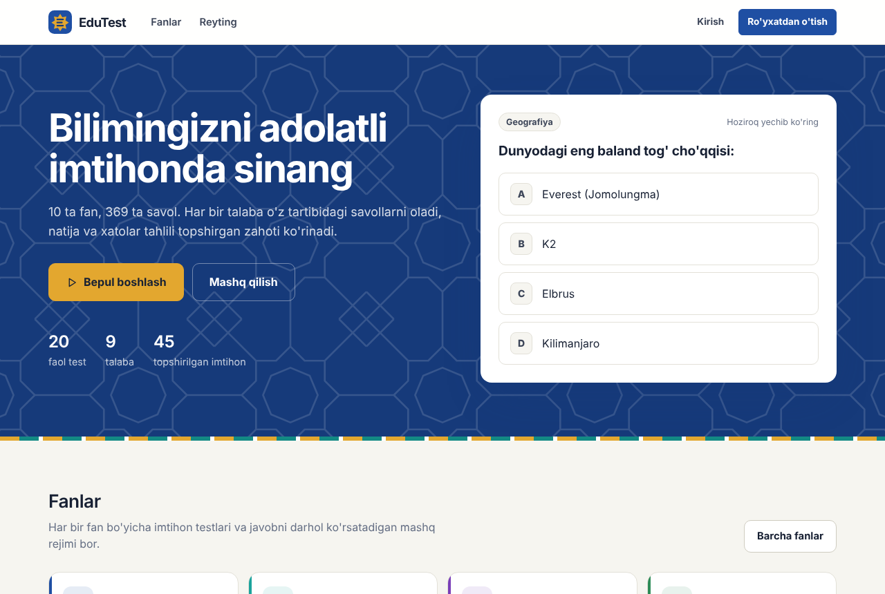
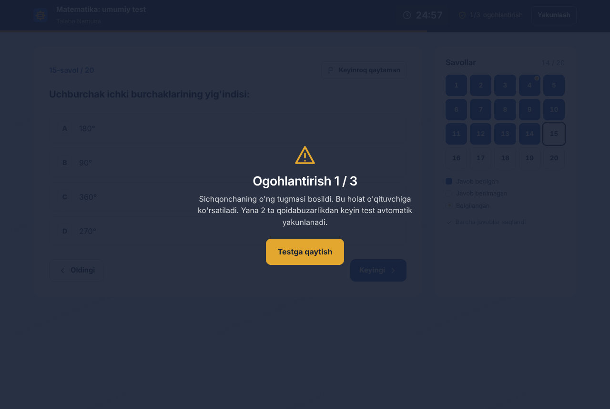
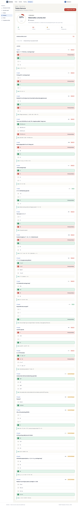
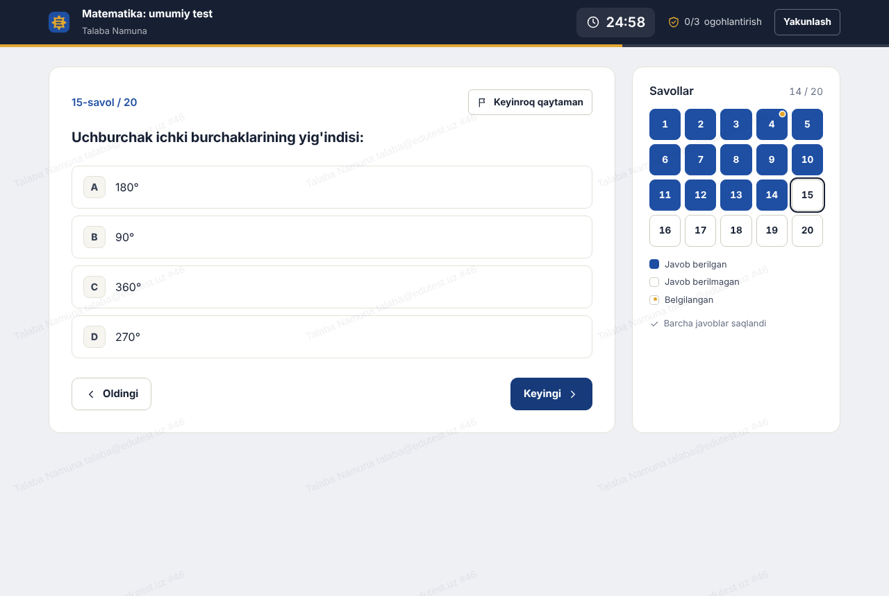
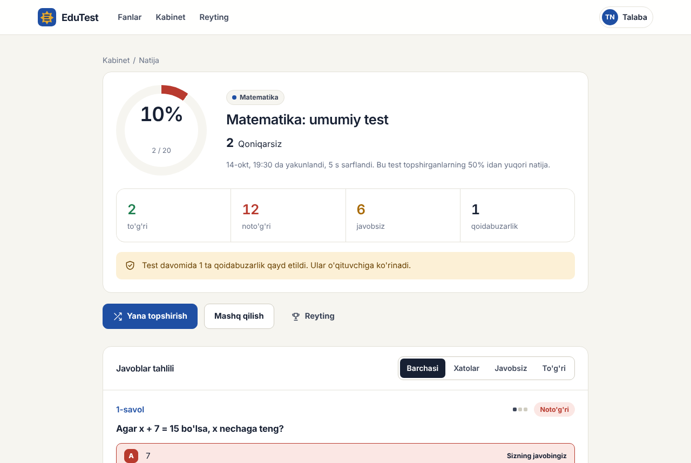
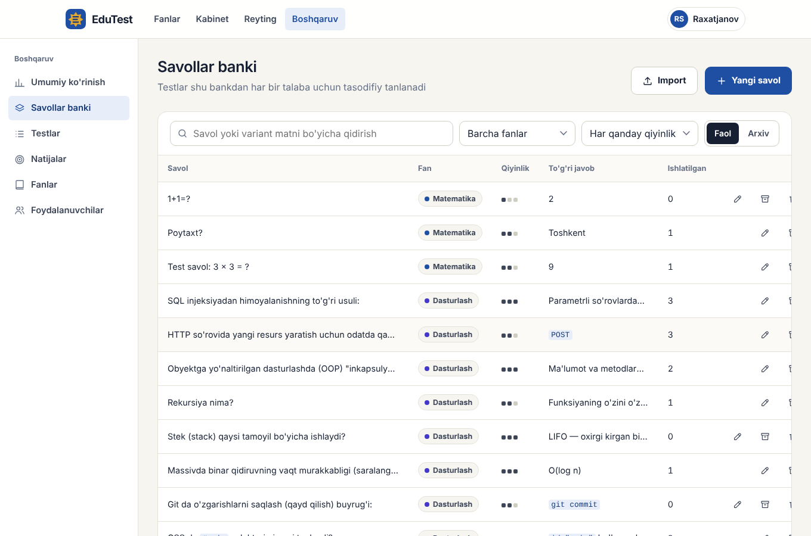
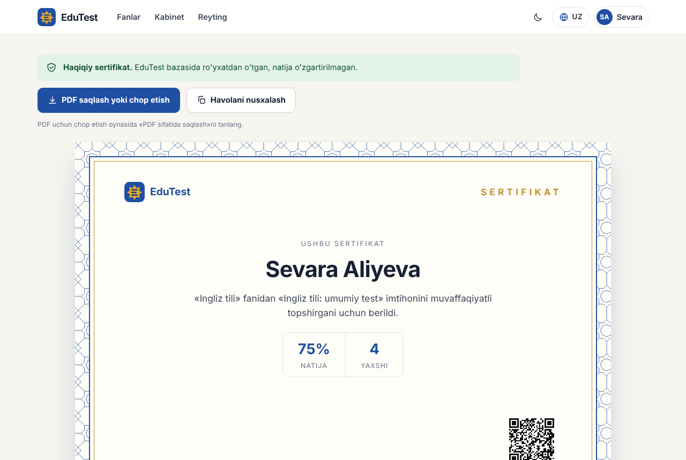
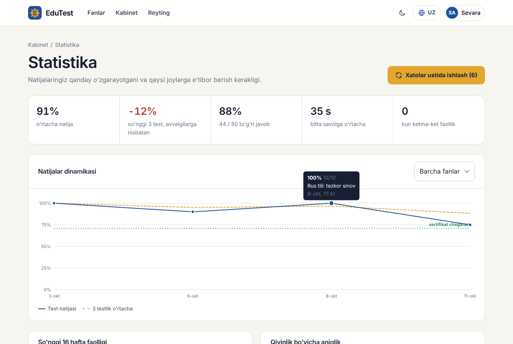
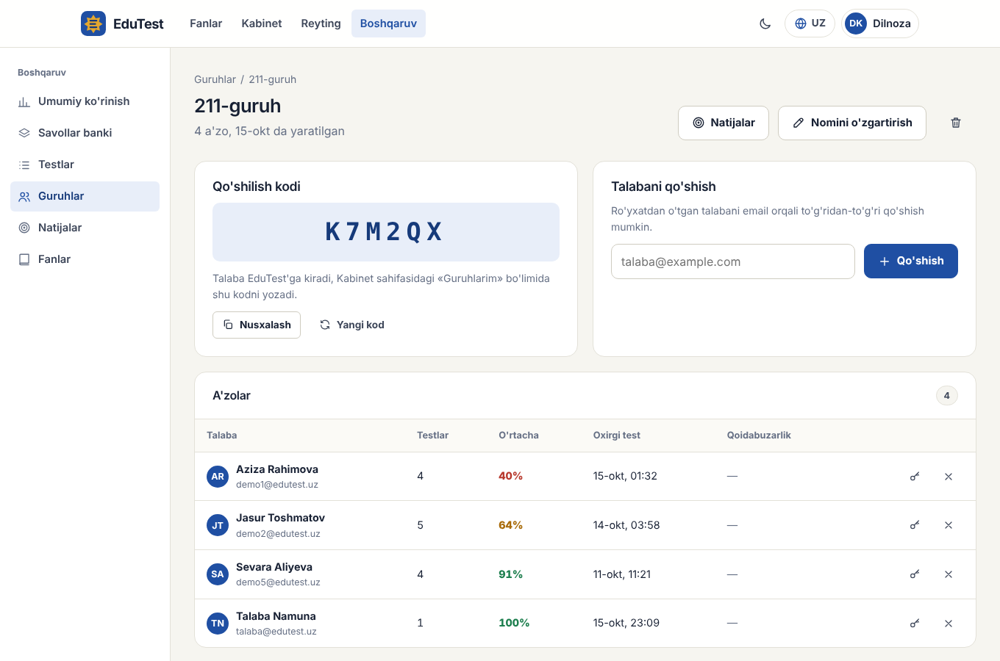
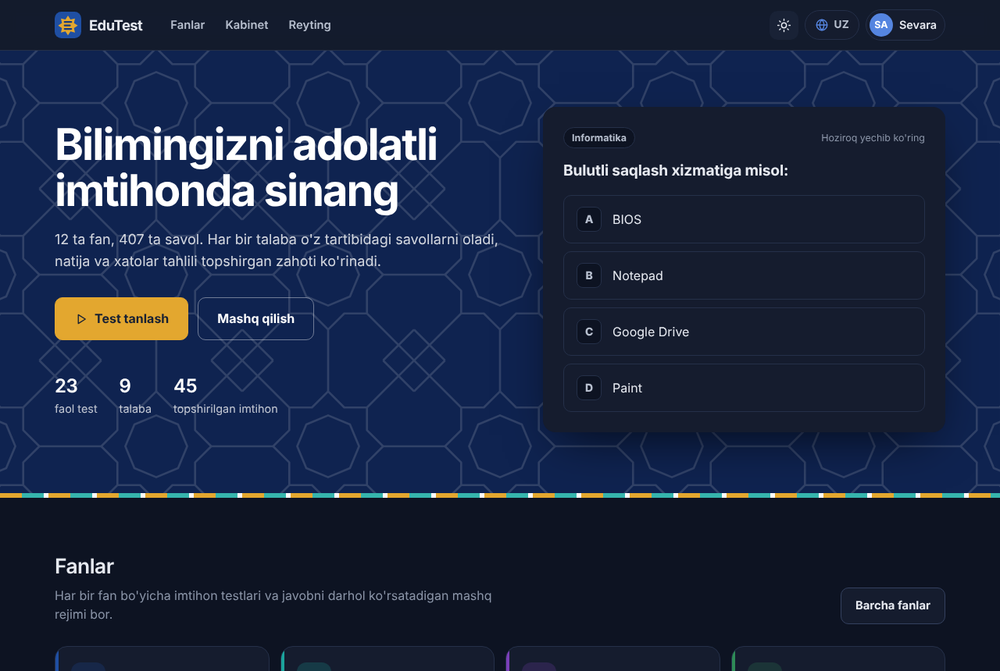

# EduTest — fanlar bo'yicha onlayn test va imtihon platformasi

Yakuniy loyiha. Muallif: **Raxatjanov Shoxrux**



EduTest — talabalar 11 ta fan bo'yicha onlayn imtihon topshiradigan va mashq qiladigan veb-platforma. Sayt **uch tilda** ishlaydi: o'zbek, rus va qoraqalpoq. Asosiy g'oya **halol imtihon**. Har bir talaba savollar bankidan o'ziga tasodifiy tanlangan savollarni aralashgan tartibda oladi. To'g'ri javoblar brauzerga hech qachon yuborilmaydi. Boshqa oynaga o'tish, nusxa olish va to'liq ekrandan chiqish qayd etiladi, chegaradan oshganda test avtomatik yakunlanadi.

## Asosiy ko'rsatkichlar

| | |
|---|---|
| Fanlar | 11 ta: Matematika, Fizika, Kimyo, Biologiya, Ona tili va adabiyot, Ingliz tili, Rus tili, Tarix, Geografiya, Informatika, Dasturlash |
| Savollar banki | **404 ta savol**, har biri izohli va 3 qiyinlik darajasida |
| Tillar | O'zbekcha, Русский, Qaraqalpaqsha — interfeys va savollar (Ingliz va Rus tili fanlaridan tashqari) |
| Tayyor testlar | 22 ta (har fanda "umumiy test" va "tezkor sinov") |
| Rollar | Talaba, O'qituvchi, Administrator |
| Tashqi paketlar | **0 ta**: faqat Node.js'ning o'zi |
| Avtomatik testlar | 33 ta (`npm test`) |
| v3 yangiliklari | Sertifikat (QR-kod bilan), guruhlar, rasmli savollar, tungi rejim, statistika, Excel'dan import, imtihon jadvali, telefonga o'rnatish, ma'lumotlarni saqlash |

## Internetga joylash (bir tugma bilan)

[](https://render.com/deploy?repo=https://github.com/sraxatjanov-sudo/edutest)

Tugmani bosing, GitHub bilan kiring va **Deploy Blueprint** (yoki **Apply**) ni tasdiqlang. Sozlamalar `render.yaml` faylidan avtomatik olinadi. 2–5 daqiqadan keyin `https://edutest-xxxx.onrender.com` ko'rinishidagi havola paydo bo'ladi.

## Ma'lumotlarni saqlash (bepul hostingda)

Bepul Render serverida disk vaqtinchalik: sayt yangilanganda yoki 15 daqiqa kirilmay "uxlab" qolib qayta yonganda baza o'chadi. Buning oldini olish uchun EduTest bazani **yopiq GitHub omboriga** avtomatik zaxiralaydi va ishga tushganda o'sha yerdan tiklaydi.

1. GitHub'da yangi ombor yarating, masalan `edutest-data`. **Private** (yopiq) ni tanlang. Bu juda muhim: bazada foydalanuvchilar ma'lumotlari bor.
2. GitHub → **Settings → Developer settings → Personal access tokens → Fine-grained tokens → Generate new token**.
   - *Repository access:* **Only select repositories** → `edutest-data`
   - *Permissions → Repository permissions → Contents:* **Read and write**
   - Tokenni nusxalab oling (`github_pat_...`).
3. Render → **edutest** xizmati → **Environment** → ikkita o'zgaruvchi qo'shing:
   - `BACKUP_REPO` = `foydalanuvchi_nomi/edutest-data`
   - `BACKUP_TOKEN` = tokenning o'zi
4. **Save** — xizmat qayta ishga tushadi. Boshqaruv panelidagi "Ma'lumotlarni saqlash" bo'limida holat ko'rinadi.

Baza har 3 daqiqada (o'zgarish bo'lsa) va server to'xtashidan oldin siqilgan holda saqlanadi. Omborda doim bitta commit turadi, shuning uchun u kattalashib ketmaydi. Ishga tushishda zaxirani o'qib bo'lmasa, eski nusxani buzmaslik uchun saqlash to'xtatiladi.

## Ishga tushirish

Talab: **Node.js 22.13 yoki yangiroq** (22 yoki 24-versiya) (`node -v` bilan tekshiring). `npm install` shart emas.

```bash
cd edutest
npm start
```

Brauzerda oching: **http://localhost:3000**

Birinchi ishga tushirishda `edutest.db` bazasi avtomatik yaratiladi va savollar, testlar hamda statistika bo'sh ko'rinmasligi uchun namunaviy natijalar bilan to'ldiriladi.

| Rol | Email | Parol |
|---|---|---|
| Administrator | admin@edutest.uz | admin123 |
| O'qituvchi | teacher@edutest.uz | teacher123 |
| Talaba | talaba@edutest.uz | talaba123 |

Kirish sahifasida bu hisoblarni bir bosishda to'ldirish mumkin.

| Buyruq | Vazifasi |
|---|---|
| `npm start` | Serverni ishga tushirish |
| `npm run dev` | Kod o'zgarganda avtomatik qayta ishga tushirish |
| `npm test` | Avtomatik testlarni ishga tushirish (alohida vaqtinchalik bazada) |
| `npm run reset` | Bazani o'chirish (keyingi `npm start` qaytadan yaratadi) |

> Shriftlar (Unbounded, Manrope) Google Fonts'dan yuklanadi. Internet bo'lmasa sayt tizim shriftlari bilan ishlayveradi.

## Imkoniyatlar

### Talaba
- Ro'yxatdan o'tish, kirish, profil va parolni o'zgartirish
- 11 ta fan, qidiruv, har bir fan sahifasida testlar va savollar banki statistikasi
- **Imtihon rejimi:** to'liq ekran, taymer, savollar xaritasi, "keyinroq qaytaman" belgisi, klaviatura bilan boshqarish (A–F, ← →)
- Har bir javob darhol serverga saqlanadi. Sahifa yopilsa ham test o'sha joydan davom etadi
- **Natija:** foiz, baho (5/4/3/2), sarflangan vaqt, boshqalarga nisbatan o'rin, xatolar bo'yicha filtrli tahlil va izohlar
- **Mashq rejimi:** javobdan keyin darhol to'g'ri variant va izoh ko'rsatiladi, natija reytingga kirmaydi
- **Kabinet:** umumiy statistika, fanlar bo'yicha o'rtacha natija, zaif fan bo'yicha tavsiya, testlar tarixi
- **Reyting:** fan, davr (7 kun, 30 kun, barcha vaqt) va o'z guruhi bo'yicha
- **Sertifikat:** yaxshi natija uchun avtomatik beriladi. A4 formatda PDF qilib saqlash yoki chop etish mumkin. QR-kod va `EDU-XXXX-XXXX` raqami orqali istalgan kishi `/sertifikat` sahifasida haqiqiyligini tekshiradi
- **Statistika:** natijalar dinamikasi grafigi, 16 haftalik faollik xaritasi, qiyinlik va fanlar bo'yicha aniqlik, ketma-ket faol kunlar
- **Xatolar ustida ishlash:** oxirgi marta noto'g'ri javob berilgan savollardan alohida mashq
- **Guruhlar:** o'qituvchi bergan 6 belgili kod bilan guruhga qo'shilish, guruh uchun maxsus testlar
- **Profil rasmi**, tungi rejim, telefonga ilova sifatida o'rnatish (PWA)

### O'qituvchi
- Umumiy ko'rinish: 14 kunlik faollik diagrammasi, fanlar bo'yicha natijalar, so'nggi qoidabuzarliklar, eng qiyin savollar
- **Savollar banki:** qidiruv, filtr, sahifalash, qo'shish, tahrirlash, arxivlash
- **Rasmli savollar:** chizma, grafik, xarita yoki formulani rasm sifatida biriktirish (brauzerda kichraytiriladi, server faylni ichidagi baytlar bo'yicha tekshiradi)
- **Ommaviy import:** **Excel (.xlsx) yoki CSV** fayldan, yoki oddiy matn formatida yuzlab savolni bir martada qo'shish, avval xatolarni tekshirish. Namuna fayl: `public/files/savollar-namuna.xlsx`
- **Guruhlar:** guruh yaratish, qo'shilish kodi, a'zolar va ularning natijalari, email orqali qo'shish, guruh bo'yicha natijalar filtri
- **Vaqtinchalik parol:** parolini unutgan talabaga yangi parol berish
- **Testlar:** savollar soni, vaqt, qiyinlik, urinishlar soni, qoidabuzarlik chegarasi, tahlilni ko'rsatish yoki yopish, **kim uchun** (hamma yoki bitta guruh), **ochilish va yopilish vaqti**, **sertifikat chegarasi**
- **Natijalar:** filtrlar, faqat shubhali natijalar, har bir urinishning qoidabuzarliklar jurnali va IP manzili, natijani bekor qilish
- Natijalarni **Excel (CSV)** ko'rinishida yuklab olish

### Administrator
- O'qituvchining barcha imkoniyatlari
- Foydalanuvchilar: rolni o'zgartirish, bloklash (sessiyalari darhol yopiladi), o'chirish
- Fanlarni, testlarni o'chirish
- Ma'lumotlarni saqlash holati va "Hozir saqlash" tugmasi

## Uch tillilik

Saytning yuqori o'ng burchagida til tanlagich bor: **UZ / RU / QQ**. Tanlangan til brauzerda eslab qolinadi.

- **Interfeys:** barcha menyu, tugma, sahifa, qoidalar, xato xabarlari va boshqaruv paneli tarjima qilingan (`public/js/i18n-dict.js`).
- **Savollar:** 9 ta fanning barcha savollari, javob variantlari va izohlari rus va qoraqalpoq tillariga tarjima qilingan (`db/questions/i18n/`). **Ingliz tili** va **Rus tili** fanlarining savollari o'z tilida qoladi, chunki ular shu tilni tekshiradi. Ona tili savollarida esa tekshirilayotgan o'zbekcha so'zlar o'zgarmaydi.
- **Server xabarlari:** xatolar, baholar va qoidabuzarlik turlari ham tanlangan tilda qaytariladi (`lib/i18n.js`).
- **Imtihon tildan mustaqil:** variantlar tartibi barcha tillarda bir xil saqlanadi. Shuning uchun imtihonni bir tilda boshlab, natijani boshqa tilda ko'rsa ham to'g'ri javob o'z joyida qoladi.
- **O'qituvchi tarjima qo'sha oladi:** savol, test va fan muharrirlarida "Tarjimalar" bo'limi bor. Tarjima kiritilmasa, asosiy (o'zbekcha) matn ko'rsatiladi.
- **Tekshiruv:** avtomatik testlar har bir tarjima asosiy savolga mos kelishini (savollar va variantlar soni, raqamli javoblar) va interfeysdagi har bir matnning tarjimasi borligini tekshiradi.

> Qoraqalpoqcha tarjimani himoyadan oldin tilni yaxshi biladigan odamga ko'rsatib olish tavsiya etiladi.

## Nusxa olishga qarshi himoya



Himoya ikki qatlamda qurilgan. Brauzerdagi cheklovlarni chetlab o'tish mumkin, shuning uchun muhim qarorlarning hammasi serverda qabul qilinadi.

**Server tomonida (chetlab o'tib bo'lmaydi):**
1. **Har kimga o'z varianti.** Savollar bankdan tasodifiy tanlanadi (`crypto.randomInt`, Fisher–Yates). Savollar va variantlar tartibi har urinishda boshqacha bo'ladi. Qo'shni talabaning "B javob" degani hech narsa bermaydi.
2. **To'g'ri javob brauzerga yuborilmaydi.** Hatto savol ID raqami ham yuborilmaydi, faqat tartib raqami boradi. Baholash faqat serverda bo'ladi.
3. **Vaqt server soati bo'yicha.** Muddat o'tgach javob qabul qilinmaydi. Fon jarayoni har 15 soniyada vaqti tugagan urinishlarni yopadi.
4. **Qoidabuzarliklar bazaga yoziladi.** Chegaraga yetganda test server tomonida yakunlanadi.
5. Bir testni bir vaqtda faqat bitta urinish bilan yechish mumkin. Urinishlar sonini cheklash ham mumkin.
6. Natija tahlilini yopish mumkin, shunda to'g'ri javoblar tarqalmaydi.

**Brauzer tomonida (aniqlash va to'sish):**
- To'liq ekran rejimi, undan chiqish qayd etiladi
- Boshqa vkladka, oyna yoki ilovaga o'tish (`visibilitychange`, `blur`)
- Matnni belgilash, nusxalash, kesish, qo'yish, o'ng tugma menyusi, sudrab olish bloklangan
- `Ctrl+C/A/P/S/U`, `F12`, `Ctrl+Shift+I/J/C`, `PrintScreen` ushlanadi va qayd etiladi
- Chop etishda sahifa bo'sh chiqadi (`@media print`)
- Ekranda talaba ismi, emaili va urinish raqami bilan **suv belgisi** turadi, shuning uchun ekran rasmi kimniki ekanligi bilinadi
- Test ikkinchi oynada ochilsa, birinchisi bloklanadi (`BroadcastChannel`)

Har bir qoidabuzarlik o'qituvchi panelida vaqti bilan ko'rinadi:



## Texnologiyalar va arxitektura

| Qism | Texnologiya |
|---|---|
| Server | Node.js `http` moduli, o'z marshrutlagichi (`lib/router.js`) |
| Ma'lumotlar bazasi | SQLite (`node:sqlite`, Node.js ichida), WAL rejimi, tranzaksiyalar |
| Mijoz | Sof JavaScript, ES modullar, History API bilan SPA |
| Dizayn | O'z dizayn tizimi: CSS o'zgaruvchilari, moslashuvchan, klaviatura bilan ishlash, `prefers-reduced-motion` |
| Testlar | `node:test` + `fetch` |

```
edutest/
├── server.js              # HTTP server, CSRF tekshiruvi, statik fayllar, fon jarayonlari
├── lib/
│   ├── http.js            # Javoblar, xavfsizlik sarlavhalari (CSP va boshqalar)
│   ├── router.js          # Marshrutlagich
│   ├── session.js         # Sessiyalar (bazada token xeshi saqlanadi)
│   ├── security.js        # scrypt, tasodifiy aralashtirish, so'rovlar chastotasini cheklash
│   ├── validate.js        # Kiruvchi ma'lumotlarni tekshirish
│   ├── exam.js            # Imtihon mantig'i: tanlash, baholash, qoidabuzarliklar, guruh va jadval
│   ├── cert.js            # Sertifikatlar
│   ├── images.js          # Rasmlarni tekshirish va saqlash
│   ├── backup.js          # GitHub'ga zaxiralash va tiklash
│   └── i18n.js            # Server xabarlari tarjimasi
├── routes/
│   ├── auth.js            # Ro'yxat, kirish, profil
│   ├── student.js         # Fanlar, mashq, urinishlar, kabinet, reyting
│   ├── admin.js           # Boshqaruv paneli API
│   └── extra.js           # Guruhlar, sertifikatlar, rasmlar, statistika, zaxira
├── db/
│   ├── index.js           # Sxema (12 ta jadval) va migratsiyalar
│   ├── seed.js            # Boshlang'ich ma'lumotlar
│   └── questions/*.js     # Savollar banki (har fan alohida faylda)
├── public/
│   ├── index.html
│   ├── css/style.css
│   ├── img/               # Logotip, girih naqshi
│   └── js/
│       ├── app.js         # Marshrutlash, navigatsiya, til va tungi rejim
│       ├── api.js, ui.js  # Server bilan aloqa, komponentlar, diagrammalar
│       ├── qr.js          # QR-kod generatori (kutubxonasiz)
│       ├── xlsx.js        # Excel/CSV o'quvchi (kutubxonasiz)
│       └── pages/         # Har bir sahifa alohida modul
├── public/sw.js           # Service worker (PWA)
├── tests/                 # Avtomatik testlar (API, v3, zaxira, tarjimalar)
├── tools/make-template.js # Excel namuna faylini yaratish
└── docs/screenshots/      # Skrinshotlar
```

### Ma'lumotlar bazasi

```
users          (id, name, email UNIQUE, password_hash, role, group_name, is_blocked, created_at, last_login)
sessions       (token [SHA-256 xesh], user_id → users, expires_at)
subjects       (id, slug UNIQUE, name, description, icon, color, sort)
questions      (id, subject_id → subjects, text, options [JSON], correct, explanation, difficulty 1–3, archived)
tests          (id, subject_id → subjects, title, question_count, time_limit, difficulty, max_attempts,
                max_violations, show_review, is_active)
attempts       (id, user_id → users, test_id → tests, status, started_at, deadline, finished_at,
                finish_reason, score, total, percent, violations, ip)
attempt_items  (attempt_id → attempts, position, question_id → questions, option_order [JSON], chosen, flagged)
violations     (id, attempt_id → attempts, type, created_at)
images         (key [tasodifiy], mime, data BLOB, size, owner_id, created_at)
groups         (id, name, code UNIQUE, teacher_id → users, created_at)
group_members  (group_id → groups, user_id → users, joined_at)
certificates   (code UNIQUE, attempt_id → attempts, user_id, name, meta [JSON], percent, issued_at)
```

`tests` jadvalida `group_id`, `opens_at`, `closes_at`, `cert_percent`, `questions` jadvalida `image`, `users` jadvalida `avatar` ustunlari bor. Eski bazalar ishga tushishda avtomatik yangilanadi (`PRAGMA user_version`).

`attempt_items` jadvali har bir talabaga berilgan savollar va variantlarning aynan qaysi tartibda ko'rsatilganini saqlaydi. Shuning uchun baholash va tahlil har doim aniq bo'ladi. Ishlatilgan savol o'chirilmaydi, faqat arxivlanadi, shunda eski natijalar buzilmaydi.

## Xavfsizlik

1. **Parollar:** `scrypt` + har parol uchun tasodifiy tuz, solishtirish `timingSafeEqual` bilan. Parol kamida 8 belgi, harf va raqam bo'lishi shart.
2. **Sessiyalar:** `HttpOnly`, `SameSite=Strict` cookie. Bazada tokenning o'zi emas, SHA-256 xeshi saqlanadi. Parol o'zgarganda yoki hisob bloklanganda hamma sessiyalar yopiladi.
3. **CSRF:** o'zgartiruvchi so'rovlar faqat `application/json` turida va shu saytning `Origin` sarlavhasi bilan qabul qilinadi.
4. **Brute-force:** kirishga 15 daqiqada 8 urinish, ro'yxatdan o'tishga soatiga 10 urinish.
5. **SQL injeksiya:** barcha so'rovlar parametrli (`?`), `LIKE` qidiruvida maxsus belgilar ekranlanadi.
6. **XSS:** foydalanuvchi kiritgan har qanday matn ekranlanadi (`esc()`). Qat'iy **Content-Security-Policy**: skriptlar faqat shu saytdan, `eval` taqiqlangan.
7. **Clickjacking:** `X-Frame-Options: DENY`, `frame-ancestors 'none'`.
8. **Rollar:** har bir API marshrutida server tomonida tekshiriladi.
9. **Path traversal:** faqat `public/` papkasidagi fayllar beriladi.
10. **CSV injeksiya:** eksportda `=`, `+`, `-`, `@` bilan boshlanadigan qiymatlar zararsizlantiriladi.
11. **Rasmlar:** fayl turi kengaytma bo'yicha emas, ichidagi baytlar bo'yicha aniqlanadi (PNG, JPEG, WebP, GIF). SVG va HTML qabul qilinmaydi. Rasm kaliti tasodifiy, taxmin qilib bo'lmaydi.
12. **Guruhlar:** o'qituvchi faqat o'z guruhlarini boshqaradi, guruh kodi va sertifikat tekshiruvi so'rovlar chastotasi bilan cheklangan.

## Savollarni import qilish formati

Boshqaruv paneli, "Savollar banki", "Import" bo'limida:

```
Suvning kimyoviy formulasi?
+H₂O
-CO₂
-NaCl
?Ikki vodorod va bitta kislorod atomi
!1

2 + 2 × 2 = ?
+6
-8
```

`+` to'g'ri javob, `-` noto'g'ri javob, `?` izoh, `!1` / `!2` / `!3` qiyinlik. Savollar bo'sh qator bilan ajratiladi. Kodni `` `teskari qo'shtirnoq` `` ichiga olsangiz, u maxsus shriftda ko'rinadi.

## API (qisqacha)

| Metod | Manzil | Kim uchun |
|---|---|---|
| POST | `/api/auth/register`, `/api/auth/login`, `/api/auth/logout` | hamma |
| GET | `/api/subjects`, `/api/subjects/:slug`, `/api/leaderboard`, `/api/stats` | hamma |
| GET/POST | `/api/practice/:slug`, `/api/practice/check` | hamma |
| GET | `/api/tests/:id` | tizimga kirgan |
| POST | `/api/tests/:id/start` | tizimga kirgan |
| GET | `/api/attempts/:id` | urinish egasi |
| PUT | `/api/attempts/:id/answer` | urinish egasi |
| POST | `/api/attempts/:id/violation`, `/api/attempts/:id/finish` | urinish egasi |
| GET | `/api/me/dashboard`, `/api/me/stats`, `/api/me/certificates`, `/api/me/groups`, `/api/practice-mistakes` | tizimga kirgan |
| POST | `/api/groups/join`, `/api/groups/:id/leave`; PUT `/api/me/avatar` | tizimga kirgan |
| GET | `/api/certificates/:code`, `/api/images/:key` | hamma |
| GET/POST/PUT/DELETE | `/api/admin/groups...`, `POST /api/images`, `POST /api/admin/users/:id/password` | o'qituvchi, admin |
| GET/POST | `/api/admin/backup` | admin |
| GET/POST/PUT/PATCH/DELETE | `/api/admin/questions`, `/api/admin/tests`, `/api/admin/subjects`, `/api/admin/attempts`... | o'qituvchi, admin |
| GET/PUT/DELETE | `/api/admin/users` | admin |

## Skrinshotlar

| Imtihon | Natija |
|---|---|
|  |  |
| **Boshqaruv paneli** | **Savollar banki** |
|  |  |
| **Sertifikat** | **Statistika** |
|  |  |
| **Guruh** | **Tungi rejim** |
|  |  |

## Himoyada aytish mumkin bo'lgan cheklovlar

- Brauzer tomonidagi himoya (nusxa, oyna almashtirish) **aniqlash** vositasi. Telefon bilan ekranni suratga olishni hech bir veb-sayt to'liq to'xtata olmaydi. Shuning uchun asosiy himoya serverda: har kimga alohida variant va suv belgisi.
- Mashq rejimi o'qitish uchun mo'ljallangan va to'g'ri javoblarni ko'rsatadi. Imtihon savollarini mashqdan alohida saqlash keyingi bosqichda qo'shilishi mumkin.
- SQLite bitta serverdagi o'quv muassasasi uchun yetarli. Juda katta yuklamada PostgreSQL'ga o'tkazish mumkin.
- GitHub'ga zaxiralash bir necha daqiqada bir bo'ladi: server kutilmaganda "qulasa", oxirgi daqiqalardagi o'zgarishlar yo'qolishi mumkin. Odatiy qayta ishga tushishda (yangilanish, uxlash) oxirgi nusxa to'xtashdan oldin saqlanadi.

## Rivojlantirish g'oyalari

- Bir nechta to'g'ri javobli va ochiq javobli savollar
- Email orqali parolni tiklash
- Veb-kamera orqali proktoring
